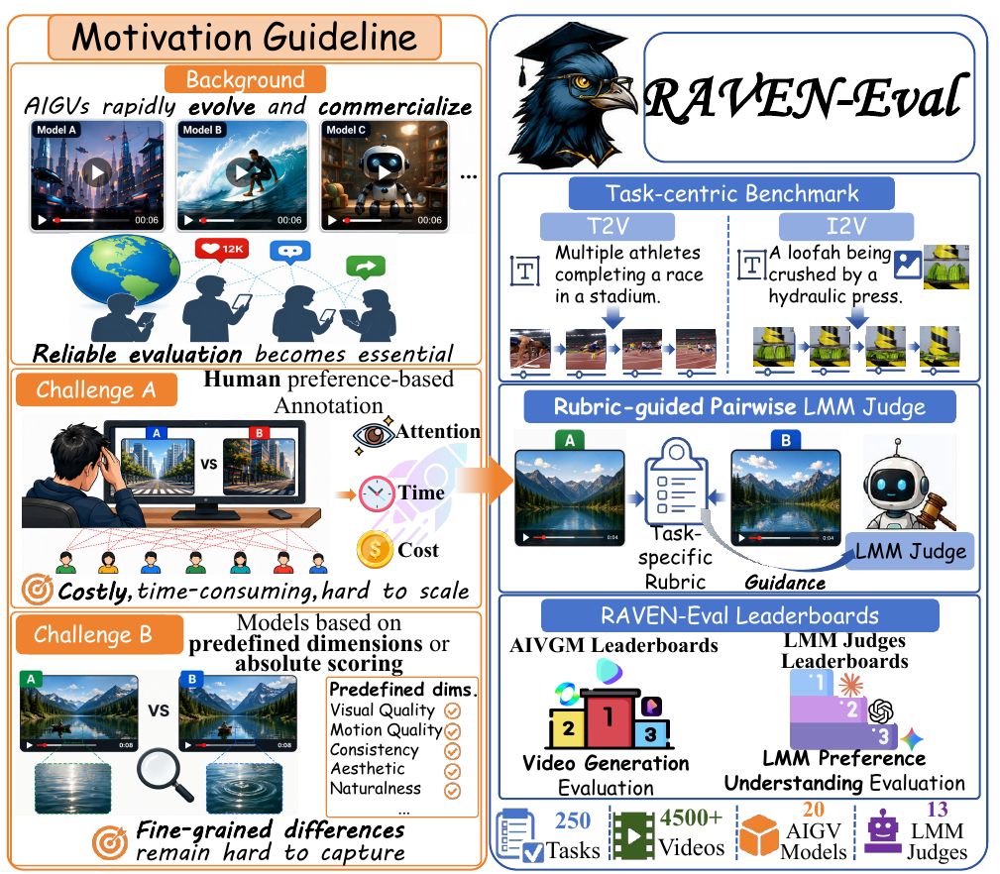
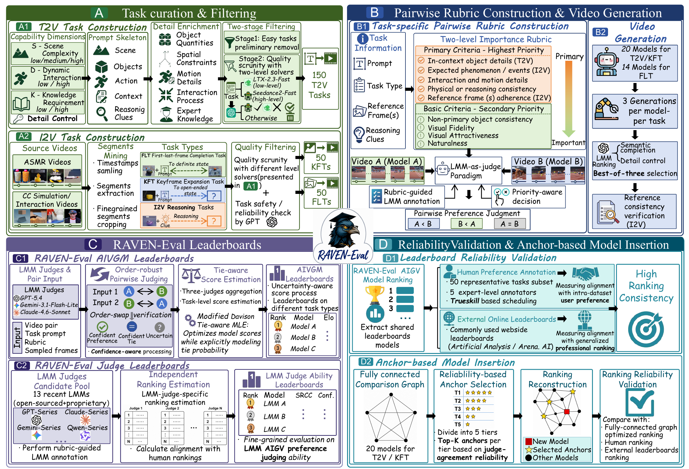
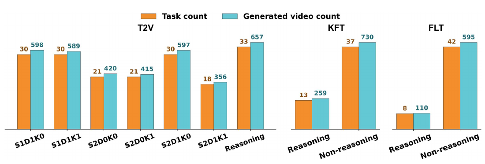

# RAVEN-Eval

**基于任务 rubric 与多模态大模型偏好判断的 AI 视频生成评测框架**

[English](README.md) · [实施协议](docs/PROTOCOL.md) · [任务数据](docs/DATA.md) · [已发布榜单](results/published)

RAVEN-Eval 通过任务级 rubric、匿名成对比较、正反向顺序校验和含平局的 Davidson 能力估计，评价视频生成模型的任务完成、细节控制与过程合理性。



## 任务与发布内容

| 类型 | 模型输入 | 评估重点 | 任务数 |
| --- | --- | --- | ---: |
| T2V 文生视频 | 文本 | 场景、数量、空间、动作、知识与推理要求 | 150 |
| FLT 首尾帧补全 | 文本和参考首尾帧 | 两端遵循、状态过渡和完整交互过程 | 50 |
| KFT 关键帧拓展 | 文本和参考首帧 | 初始状态遵循及后续现象的合理演化 | 50 |

报告评估20个视频生成模型及13个LMM评委；T2V、KFT各20个生成模型，FLT为14个。**本次榜单评测完成日期：2026年7月31日。**

仓库包含250个任务文本、150张I2V参考图、可运行的核心评测代码、三类参考榜单及Overall综合榜。**任务文本快照与论文最终T2V分类存在版本差异**；尚未包含完整的最终任务ID映射、原始成对判断和全部生成视频，因此不将该快照标为可直接复现论文数值的最终评测集。具体范围见[数据说明](docs/DATA.md)。

## 主要方法框图



1. 构建有区分度的任务，制定“首要要求优先”的任务级rubric。
2. 每模型每任务生成3个候选，由固定评委选1个；I2V另核验参考帧遵循。
3. 每视频均匀采样8帧，附prompt、rubric及所需参考图，以Model A/B隐藏模型身份。
4. 三位固定评委分别判断A/B和B/A，识别稳定胜负、稳定平局及不确定结果。
5. 根据稳定判断比例对模型对赋权，逐任务拟合Davidson模型并中心化技能分数。
6. 跨适用任务计算`mean − std`，转换为Elo-style分数，通过按任务分层的模型对bootstrap计算置信区间。

报告的固定评委为GPT-5.4、Claude Sonnet 4.6、Gemini 3.1 Flash-Lite；候选选优评委另行固定。本实现调用Responses兼容接口，其他原生API需由网关或适配器转换。

## 环境要求与安装

- Python 3.10及以上；Linux、macOS或Windows WSL。
- 系统可执行`ffmpeg`和`ffprobe`；评估工具使用POSIX文件锁。
- Python依赖：NumPy、SciPy、certifi，安装时自动处理。
- API生成与评估、CPU统计排序不需要本地GPU；远程模型访问需自行配置凭据。

```bash
# Ubuntu / Debian
sudo apt-get update
sudo apt-get install -y ffmpeg python3-venv

# 在仓库根目录执行
python3 -m venv .venv
source .venv/bin/activate
python -m pip install --upgrade pip
python -m pip install -e .
```

macOS可用`brew install ffmpeg`安装系统依赖。请在仓库根目录使用本地可编辑安装，保持数据和guideline与源码同时可用。

## 无需API的快速验证

```bash
python -m raven_eval.demo --output-dir runs/demo
python -m unittest discover -s tests -v
python tools/validate_release.py
```

离线demo生成简单的合成视频并注入明确标注的合成判断，用于验证建图、Davidson和bootstrap流程；它不代表真实模型的评测结果。

## 实施流程

### 1. 生成与选优

可接入已有模型生成结果，也可通过统一[生成适配接口](docs/GENERATION.md)运行。生成模型只接收公开prompt和参考图，不接收rubric。

```bash
python -m raven_eval.generate \
  --task-type t2v --task-id T2V_L1_D1_K1_0006 \
  --model my-generator --model-version my-version \
  --provider examples.provider_adapter:generate \
  --output-dir runs/my-generator --dry-run
```

示例provider是接口模板，实际调用前需对接真实API。已有视频可按[示例清单](configs/selected_videos.example.jsonl)登记，每任务每模型只标记一个`selected:true`结果；示例路径需替换。生成三个候选后，可用`python -m raven_eval.select --help`查看匿名选优入口。该选优入口尚不自动执行报告中的独立0.98像素相似度门槛，需先固定该校验定义并核验I2V输出。

### 2. 构建比较图

```bash
python -m raven_eval.pairs \
  --videos runs/selected_videos.jsonl --output-dir runs/pairs
```

加入后的全库正式模型数**≤25**时，每任务构建全联通比较图，第25个仍如此；**从第26个开始**采用selected anchors，并保留历史全联通基座。超过25时需显式提供十个锚点和新模型ID。25是本项目部署规则，完整实现与适用范围见[接入协议](docs/PROTOCOL.md#incremental-model-insertion)。

### 3. 匿名LMM评估

在环境中设置`LMM_API_KEY`、`JUDGE_MODEL`及`JUDGE_API_URL`，不将密钥写入源码或命令示例。

```bash
# 只读预览，不调用API或写文件
python -m raven_eval.judge \
  --task-types t2v --model "$JUDGE_MODEL" --api-url "$JUDGE_API_URL" \
  --output-base judge_1 --dry-run

# 正式执行
python -m raven_eval.judge \
  --task-types t2v --model "$JUDGE_MODEL" --api-url "$JUDGE_API_URL" \
  --output-base judge_1
```

另外两位评委使用不同配置及`judge_2`、`judge_3`字段；FLT使用`--task-types first_last`，KFT使用`--task-types keyframe`。默认隐藏模型名称、均匀抽8帧；只有显式传入`--show-model-names`才展示真实名称。1fps历史协议与8帧协议分别记录，不能混用。

### 4. 排序与置信区间

```bash
python -m raven_eval.ranking \
  --input-dir runs/pairs/t2v \
  --judge-base judge_1 --judge-base judge_2 --judge-base judge_3 \
  --bootstrap-rounds 200 --bootstrap-pairs 2000 --seed 20260631 \
  --output-dir runs/results/t2v
```

三类分别运行。Overall在同一个命令中重复传入三类`--input-dir`，合并适用任务技能分数后计算综合分；不平均三个类别的Elo或排名。不支持的任务不记零分，普通生成失败不应被重标为不支持。

输出`leaderboard.csv`、`leaderboard.json`和`task_scores.csv`。新运行的CI提供上下界；`--bootstrap-rounds 0`只计算点估计。完整公式、正则归一化、bootstrap边界及与历史工具的差异均见[实施协议](docs/PROTOCOL.md)。

## 榜单与案例

三类榜单和Overall参考结果见[results/published](results/published)。新运行结果放在Git忽略的`runs/`中，不覆盖参考榜单。



[案例展示](docs/EXAMPLES.md)提供橡皮鸭、白色馒头、高温铁球与气球的选定模型生成视频及相应I2V参考图。

## 引用与许可证

引用格式见[CITATION.cff](CITATION.cff)及[英文README](README.md#citation-and-release-scope)。代码许可证尚待维护者选择，未自行指定MIT或Apache；媒体的来源与使用范围单独说明，见[许可证状态](LICENSE_NOTICE.md)。
