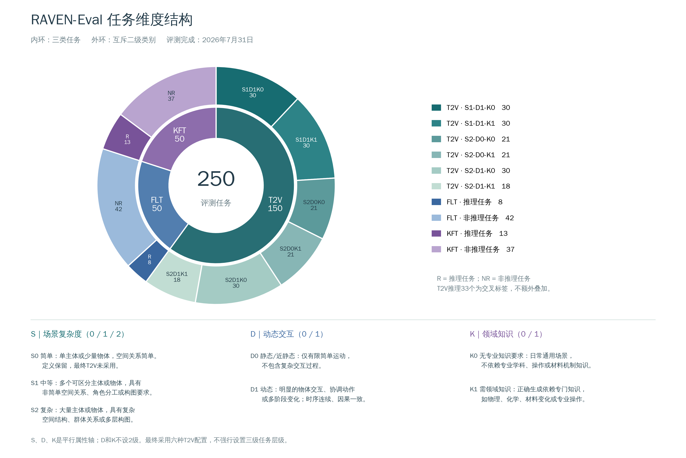

# Task data and versioning

## Included data

`data/manifest.json` indexes 250 normalized task JSON files: 150 T2V, 50 FLT, and 50 KFT. The release provides 150 reference images: 100 endpoint images for FLT and 50 starting images for KFT. T2V does not use reference images.

Task JSON fields:

```json
{
  "task_id": "T2V_L1_D1_K1_0006",
  "task_type": "t2v",
  "prompt": "Public text supplied to the generator",
  "rubric": "Task-specific criteria supplied only to judges",
  "references": {},
  "snapshot_sdk": {"S": 1, "D": 1, "K": 1},
  "reasoning": null,
  "task_version": "workspace_text_snapshot_v1"
}
```

The example illustrates the schema, not the actual prompt text. Reference paths are repository-relative. Manifest SHA-256 hashes cover the task JSON files. Prompts and rubrics remain in their original language; the release does not invent translated evaluation targets.

## Snapshot versus final reported split

The source task export retained only prompts/rubrics. This release recovers task IDs from filenames and reference images from the corresponding task records. It does not infer absent reasoning labels from wording. `reasoning: null` means unavailable in this snapshot, not non-reasoning. `snapshot_sdk` records legacy filename labels, not a newly adjudicated final classification.

Although both collections contain 250 tasks, the text snapshot and final benchmark classification are not interchangeable. The snapshot includes S0 and S1–D0 T2V candidates. The final reported T2V split retains six configurations:

| Final reported configuration | Tasks |
| --- | ---: |
| S1–D1–K0 | 30 |
| S1–D1–K1 | 30 |
| S2–D0–K0 | 21 |
| S2–D0–K1 | 21 |
| S2–D1–K0 | 30 |
| S2–D1–K1 | 18 |

The reported reasoning counts are T2V 33, FLT 8, KFT 13; they are not labels asserted for this export. Do not infer the final task list or fabricate final reasoning annotations from the matching total alone. Full paper-level data reproduction needs a versioned final task-ID mapping and matching generated outputs/judgments.

The known duplicate FLT export was resolved by retaining task ID `youtube_N2aR2yE63iE_0002_L1_D1_K1` and excluding its `_0001_` counterpart. Reference images for missing cached endpoints were recovered from the task's actual reference clip.

## S / D / K definitions

- **S0:** one subject or a few objects, simple spatial arrangement; not retained in the final T2V configurations.
- **S1:** several distinguishable subjects/objects with nontrivial spatial relationships, roles, or compositional requirements.
- **S2:** numerous subjects/objects with complex spatial, group, or multilayer composition.
- **D0:** static or nearly static; limited simple motion, without complex interaction.
- **D1:** clear dynamic interaction, coordinated actions, or multistage state transitions; temporal and causal coherence matter.
- **K0:** general-purpose scenarios without specialized disciplinary, operational, or material knowledge.
- **K1:** accurate visual realization requires domain knowledge, such as physics, chemistry, material behavior, or professional procedures.

S has levels 0/1/2. D and K have only levels 0/1. They are parallel attributes, not three hierarchy depths. Reasoning is a separate tag.



## Media and provenance

Reference images are visual inputs for their associated FLT/KFT tasks. Complete third-party source videos and the full generator-output archive are not redistributed in this repository. Three selected generated examples are provided with model/version labels in [EXAMPLES.md](EXAMPLES.md).

Third-party visual content and model outputs retain their source-specific terms. A future code license should not be interpreted as automatically licensing external media. The maintainer's code-license decision is tracked separately in [LICENSE_NOTICE.md](../LICENSE_NOTICE.md).

No credentials, full runtime records, private logs, or absolute storage paths are part of the task export. To evaluate other data, prepare task JSONs with this schema and a selected-video JSONL manifest, and assign a distinct task version.
