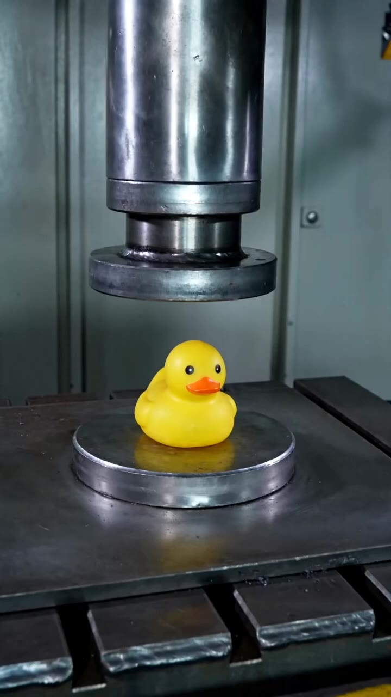
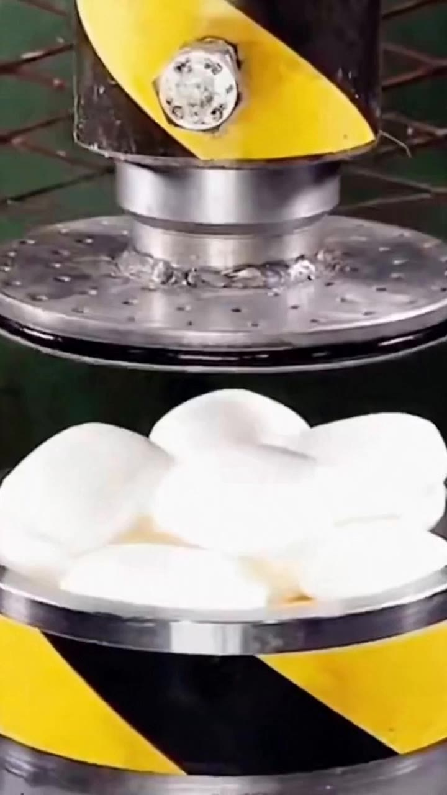
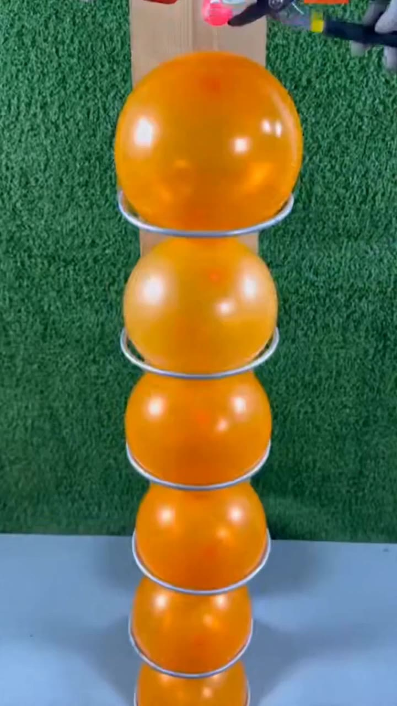

# Example videos

These are selected existing generated outputs, identified by their recorded model versions. Some original generation workflows removed audio. The repository does not label them as untouched raw API downloads.

| Case | Task | Model | Recorded API/version | Generated video |
| --- | --- | --- | --- | --- |
| Rubber duck / 橡皮鸭 | T2V | Seedance 2 | `doubao-seedance-2-0-260128` | [MP4](assets/examples/t2v/generated.mp4) |
| Steamed buns / 白色馒头 | FLT | Seedance 2 Fast | `doubao-seedance-2-0-fast-260128` | [MP4](assets/examples/flt/generated.mp4) |
| Hot iron ball and balloons / 高温铁球与气球 | KFT | Seedance 2 Fast | `bytedance/seedance-2.0-fast` | [MP4](assets/examples/kft/generated.mp4) |

## Rubber duck — T2V

This is a pure text-to-video task. No reference video or image is bound to the task.

## Steamed buns — FLT

Reference endpoints: [first frame](assets/examples/flt/reference_first.png) · [last frame](assets/examples/flt/reference_last.png).

## Hot iron ball and balloons — KFT

Reference input: [first frame](assets/examples/kft/reference_first.png).

Machine-readable case IDs, versions, and media paths are in [the example manifest](assets/examples/manifest.json). The complete original source-video collection is not included in the public source repository.
